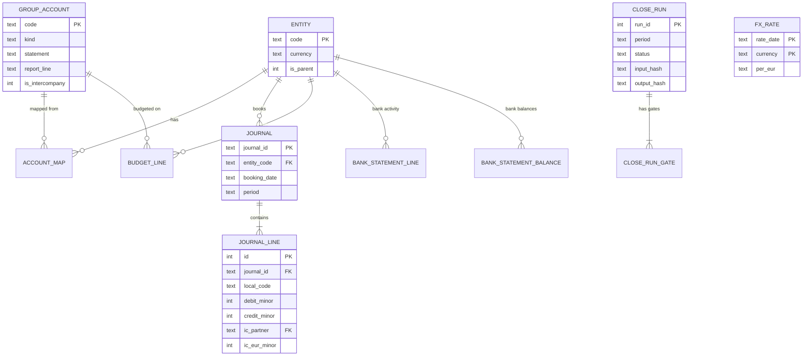

# Data model

The full DDL is in `src/nordic_close/schema.sql`. This page explains the design choices.

## Decisions

**Integer minor units.** SQLite has no decimal type, and a `REAL` column would turn `0.1 + 0.2`
into a reconciliation problem. All four currencies in the group use two decimals, so amounts
are stored as integers (öre, øre, cent) and converted to `Decimal` at the edge of the database
layer. Exchange rates are stored as text and parsed with `Decimal`, so nothing is rounded on the
way in.

**Two charts of accounts.** Each entity posts in its own local account codes (Swedish codes
loosely follow BAS, Norwegian codes follow the NS 4102 numbering). `account_map` maps them onto a
short group chart. Reports and eliminations only ever see group accounts.

**Journals and lines.** A journal is the unit that must balance. The balance check happens in the
loader and is repeated as a test over the stored data, because the database cannot express "sum
of lines is zero" as a constraint.

**Intercompany fields.** An intercompany line carries the counterparty entity and the amount in
EUR, the invoicing currency. Comparing EUR amounts between the two sides is what makes a
disagreement a real difference rather than an exchange-rate artefact.

**Periods.** `period` is `YYYY-MM` text, derived from the booking date and stored on the journal so
trial balances can be grouped without date maths in SQL.

**Run history.** `close_run` and `close_run_gate` are append-only. Each run keeps the hash of its
inputs and of its outputs, so a number in an old pack can be traced to a run and the run can be
repeated.
